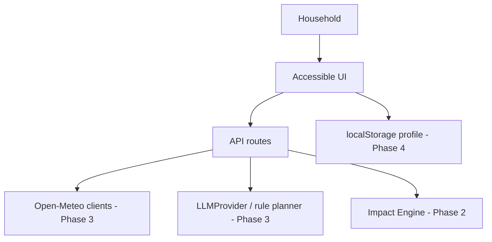

# SaafSaans

**Clearer choices for smog days** — a GenAI assistant that helps families and communities navigate severe winter smog and urban air pollution.

[](https://github.com/bharath0757/saafsaans-ai/actions/workflows/ci.yml)
[](https://github.com/bharath0757/saafsaans-ai/actions/workflows/codeql.yml)

## Problem

Families in smog-affected Indian cities need plain-language guidance: when to go out, how to cut indoor exposure, and which low-emission swaps actually help — with numbers they can trust.

## Solution

SaafSaans combines live air-quality context (Open-Meteo), a **deterministic Impact Engine** for every figure, and optional GenAI for personalised explanations. With no API key, a rule-based planner still works. Profiles stay on-device; nothing health-related is logged server-side.

## Build status

| Phase              | Status      | Notes                                                               |
| ------------------ | ----------- | ------------------------------------------------------------------- |
| 1 Foundation       | Done        | Scaffold, AQI domain, CSP, health API, CI                           |
| 2 Impact Engine    | Done        | CPCB breakpoints, IAQ mass balance, exposure dose, actions, impact  |
| 3 Services & API   | Done        | Open-Meteo clients, LLMProvider (Gemini/Anthropic/Rule-based), API  |
| 4 Experience       | Done        | Accessible UI, Onboarding, AQI ladder, 24h strip, Tabs, Impact card |
| 5 Community & chat | Not started |                                                                     |
| 6 Hardening        | Not started |                                                                     |

## Problem-statement traceability

| Requirement                   | Feature                         | File(s)                                                                     | Test                                                                               | Status             |
| ----------------------------- | ------------------------------- | --------------------------------------------------------------------------- | ---------------------------------------------------------------------------------- | ------------------ |
| Suggest low-emission routines | Daily plan generation & UI      | `src/components/dashboard/RoutineTab.tsx`, `src/app/api/plan/route.ts`      | `tests/components/PlanTabs.test.tsx`, `tests/api/routes.test.ts`                   | Done               |
| Indoor air quality hacks      | Indoor mass-balance + purifiers | `src/components/dashboard/IndoorTab.tsx`, `src/domain/indoor.ts`            | `tests/components/PlanTabs.test.tsx`, `tests/domain/indoor.test.ts`                | Done               |
| Sustainable alternatives      | Transport / fuel swaps          | `src/components/dashboard/SwapsTab.tsx`, `src/domain/transport.ts`          | `tests/components/PlanTabs.test.tsx`, `tests/domain/transport.test.ts`             | Done               |
| Tailored to location          | Open-Meteo AQI + Geocoding APIs | `src/components/onboarding/StepLocation.tsx`, `src/services/air-quality.ts` | `tests/components/OnboardingWizard.test.tsx`, `tests/services/air-quality.test.ts` | Done               |
| Explain direct impact         | Impact Engine (dose + CO2e)     | `src/components/dashboard/ImpactCards.tsx`, `src/domain/impact.ts`          | `tests/components/ImpactCards.test.tsx`, `tests/domain/impact.test.ts`             | Done               |
| Follow-up chat                | Scoped streaming chat API       | `src/app/api/chat/route.ts`, `src/services/llm/`                            | `tests/api/routes.test.ts`, `tests/services/llm.test.ts`                           | Done (API+service) |
| Right-now verdict             | AQI band + action sentence      | `src/components/dashboard/VerdictHero.tsx`, `src/domain/aqi.ts`             | `tests/components/VerdictHero.test.tsx`, `tests/domain/aqi.test.ts`                | Done               |
| Repo &lt; 10 MB               | Size guard                      | `scripts/check-size.mjs`                                                    | `npm run check:size`                                                               | Done               |

## How it works



## Impact Engine

The Impact Engine is fully deterministic, unit-tested, and property-tested:

- **Pollutant sub-indices ($I_p$):** CPCB linear interpolation table across PM2.5 and PM10 24-hr breakpoints (`src/domain/pollutants.ts`).
- **Indoor IAQ:** Single-zone steady-state mass-balance equation $C_{in} = \frac{P \cdot a \cdot C_{out} + S/V}{a + k_d + \text{CADR}/V}$ (`src/domain/indoor.ts`).
- **Inhaled Dose:** Micro-environment activity-weighted intake $\text{Dose} = \sum (C_i / \text{APF}_{\text{mask}} \times \text{Rate} \times \text{Hours})$ (`src/domain/exposure.ts`).
- **Sustainable Alternatives:** Modal shifts (walk, cycle, 2-wheeler, car, bus, metro) computing PM2.5 exposure deltas and $\text{g CO}_2\text{e/pkm}$ (`src/domain/transport.ts`), and cooking fuel clean transitions (`src/domain/actions.ts`).
- **All formulas, ranges, and primary sources cited:** [ASSUMPTIONS.md](docs/ASSUMPTIONS.md). The LLM never invents numbers.

## Features (sample)

Phase 1 ships the accessible shell: answer-first hero, AQI ladder with band icon + label, skip link, en/hi/te dictionaries, `/api/health`.

## Tech stack

| Choice                                         | Why                                 |
| ---------------------------------------------- | ----------------------------------- |
| Next.js 16 App Router                          | Vercel-ready, Proxy CSP nonces      |
| TypeScript strict + `noUncheckedIndexedAccess` | Fewer silent undefined bugs         |
| Tailwind 3 + `tokens.ts`                       | One colour source; no large UI kits |
| Zod 4                                          | Env and API validation              |
| Vitest + axe + fast-check                      | Unit, a11y, property tests          |

## Quick start

```bash
npm ci
cp .env.example .env.local
npm run dev
```

No API keys required for Phase 1. Later phases keep a rule-based planner when LLM keys are absent.

## Evaluation criteria map

### Code quality

Strict TS, no `any`, ESLint complexity/size limits, layered `domain` / `lib` / `app`, TSDoc, ADRs in `docs/adr/`.

**Verify:** `npm run lint && npm run typecheck`

### Security

Nonce CSP (`src/proxy.ts`), static headers, Zod env, rate limiter, redacting logger, Dependabot, CodeQL, `SECURITY.md`.

**Verify:** `npm audit --omit=dev --audit-level=high` and `tests/lib/csp.test.ts`

### Efficiency

No web fonts, SVG icons only, repo soft budget 5 MB, air-quality caching in Phase 3.

**Verify:** `npm run check:size`

### Testing

Vitest coverage thresholds, domain + contrast + a11y + health API tests.

**Verify:** `npm run test:coverage`

### Accessibility

`jsx-a11y` strict, axe on home shell, skip link, focus rings, dark + `forced-colors` CSS hooks, CVD-aware AQI shapes.

**Verify:** `npm run test -- tests/components/HomeHero.test.tsx`

### Problem-statement alignment

Traceability table above; educational-estimate disclaimer in footer.

## Testing summary

Run `npm run test:coverage` for the current line/branch numbers (reported at each phase exit).

## Security and privacy

See `SECURITY.md`. Location and household health fields are browser-only by design.

## Accessibility statement

Target WCAG 2.2 AA. Phase 1 establishes landmarks, one `h1`, skip link, focus styles, and axe coverage on the home shell.

## Performance and size

Tracked repo must stay under 5 MB (`check:size`). First-load JS budget (&lt; 150 KB) enforced in Phase 6.

## Project structure — where to look first

| Look here              | For                 |
| ---------------------- | ------------------- |
| `src/domain/aqi.ts`    | National AQI bands  |
| `src/design/tokens.ts` | Colours and type    |
| `src/proxy.ts`         | CSP nonce           |
| `src/app/api/health`   | Health probe        |
| `docs/ARCHITECTURE.md` | Diagrams and layers |
| `docs/ASSUMPTIONS.md`  | Cited constants     |

## Limitations

Phase 1 uses a **demo AQI** on the home page. Live data, Impact Engine maths, onboarding and chat arrive in later phases.

## Contributing and licence

See `CONTRIBUTING.md`. MIT — `LICENSE`.
