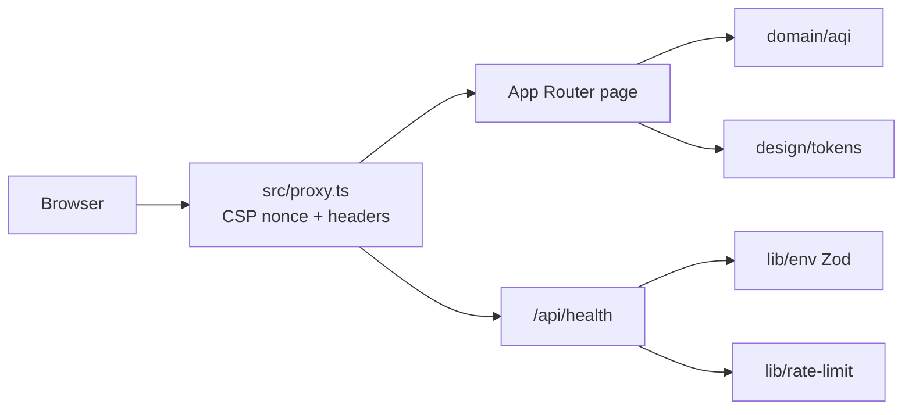

# Architecture

SaafSaans is a Next.js App Router application with a strict inward dependency rule:

```
UI / API  →  services  →  domain
                ↓
               lib
```

`domain/` is pure TypeScript with no I/O. `services/` talk to Open-Meteo and LLM providers (Phase 3). `app/api/` handlers validate with Zod, apply rate limits, call a service, and shape the response. Components never import services directly for business math.

## Request path (Phase 1)



## Security boundaries

- Secrets only via server env (`lib/env.ts`); never logged (see `lib/logger.ts` redaction).
- Per-request CSP nonce from `proxy.ts`; static headers from `config/security-headers.mjs`.
- Household profiles stay in the browser (`localStorage` from Phase 4); health fields are never sent to logs.
- Outbound host allowlist and SSRF guards arrive with Phase 3 clients.

## Impact Engine (Phase 2)

Deterministic modules under `src/domain/` will compute every numeric claim. The LLM personalises copy only; a rule-based planner works with no API key.

## Key folders

| Path             | Role                                           |
| ---------------- | ---------------------------------------------- |
| `src/domain`     | Pure AQI / impact logic                        |
| `src/lib`        | Env, logger, CSP, Result, rate limit, contrast |
| `src/design`     | Tokens                                         |
| `src/components` | Accessible UI                                  |
| `src/i18n`       | en / hi / te dictionaries                      |
| `src/app/api`    | Thin route handlers                            |
| `tests`          | Mirrors src; coverage gates in Vitest          |
| `docs/adr`       | Architecture decision records                  |
